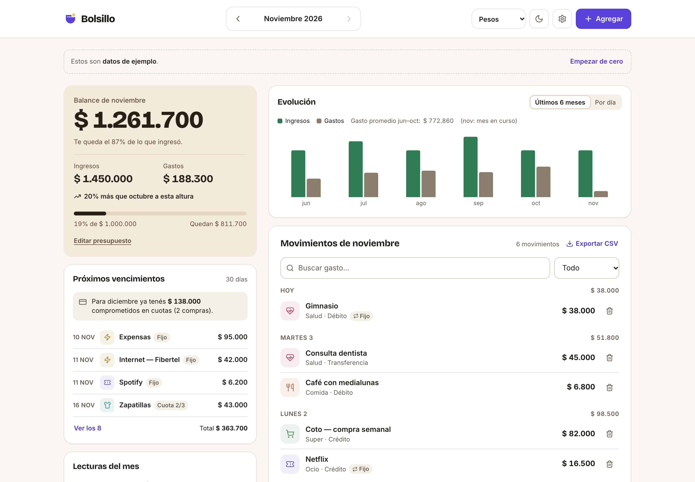

# Bolsillo

App web de gastos personales: cargás un gasto en segundos y ves cuánto llevás gastado en el mes, contra tu presupuesto y contra el mes anterior.

> Proyecto conceptual — diseño y desarrollo: Mateo Alzari

## Qué hace

- **Gastos e ingresos** (sueldo, freelance, otros). La tarjeta principal muestra el balance del mes, ingresos, gastos, la comparación con el mes anterior y el presupuesto, con avisos al 80% y al 100%.
- **Compras en cuotas** (1 a 24) con tarjeta de crédito: el total se reparte en una fila por mes ("Cuota 2/6") y se avisa cuánto hay comprometido en cuotas para el mes que viene. Editar o borrar una cuota actúa sobre la compra completa.
- **Gastos e ingresos fijos mensuales**: se generan solos cada mes. Si se borra uno a mano, ese mes no se vuelve a generar. La sección **Próximos vencimientos** muestra fijos y cuotas de los próximos 30 días.
- **Evolución** de los últimos 6 meses (ingresos vs. gastos), con el detalle **por día** en una pestaña.
- **Lecturas del mes**, calculadas con tus datos: la categoría que más creció contra el promedio de los 3 meses anteriores (sin cuotas), el día de más gasto (sin fijos ni cuotas) y cuánto pesan los gastos fijos sobre los ingresos.
- **Ver en dólares** (oficial o blue) con la cotización del día de [dolarapi.com](https://dolarapi.com). Si la API falla, todo sigue en pesos y se avisa.
- Lista agrupada por día, con búsqueda y filtro por tipo o categoría. Exportación a CSV, modo claro y oscuro, y datos de ejemplo de 6 meses.

Las cuotas con fecha futura no cuentan como gastadas hasta su fecha: se ven en "Próximos vencimientos". Todo se guarda en `localStorage` (con migración desde la versión 1). No hay backend.



## Stack

React 18 + Vite + TypeScript · Recharts (gráfico por día) · lucide-react (íconos) · Vitest.

## Estructura

```
src/
  lib/            lógica pura, sin React (con tests)
    stats.ts      balance, totales, por categoría, por día, 6 meses, presupuesto, comparación, filtros
    installments.ts  cuotas
    recurring.ts  fijos mensuales y próximos vencimientos
    insights.ts   lecturas automáticas
    currency.ts   cotización del dólar y conversión
    money.ts      formato $ 12.500 y lectura de montos
    dates.ts      meses y días en español
    csv.ts        exportación
    seed.ts       datos de ejemplo
    storage.ts    lectura/escritura en localStorage
  components/     piezas de la interfaz
  hooks/useTheme  modo claro/oscuro
scripts/contrast.mjs   verifica el contraste WCAG de la paleta
docs/                  propuestas de estilo iniciales y capturas
```

## Comandos

```bash
npm install
npm run dev        # desarrollo
npm test           # tests de la lógica
npm run contrast   # chequeo de contraste de colores
npm run build      # build de producción en dist/
npm run preview    # sirve el build en http://localhost:4180
```

## Accesibilidad

- Textos chicos con contraste ≥ 4,5:1 y gráficos ≥ 3:1, en los dos modos (`npm run contrast`).
- Todo se puede usar con teclado; los diálogos atrapan el foco y se cierran con Escape.
- Labels en todos los campos, errores asociados con `aria-describedby` y avisos con `aria-live`.
- Respeta `prefers-reduced-motion`.
